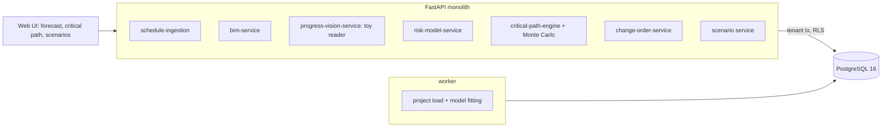

# AI Construction Project Risk & Delay Prediction

For a general contractor's project controls team: it takes schedule updates and BIM elements, forecasts when the project really
finishes with a band around the date and the cost that goes with it, names the activities and suppliers that decide it, shows what a
late delivery or a wet spell does before it happens, compares a site photo with the schedule, and simulates a change order's best,
expected and worst completion before anyone signs it.

Built from blueprint 8 of "Advanced Engineering Build Book, Volume III" as a **vertical slice**: the demo scenario end to end,
with the platform parts real and the rest listed under [Not built](#not-built-and-why).

**The project, its 600 activities, the twenty past projects the models learn from, the suppliers and the site photo all come from a
simulator in this repository. The photo reader counts coloured rectangles in a schematic image and is not a vision model. The past
projects come from the same process as the one being forecast, which is the generous case; a real history would be from other
buildings.**

## Run it

```bash
docker compose up --build        # migrates, seeds, serves http://localhost:8218/ui/ with one worker
docker compose run --rm test     # 13 tests against a throwaway database (about 6 s)
```

Open http://localhost:8218/ui/ and press **Run all steps** (about 10 seconds), or `make bootstrap demo`.
Demo tokens (local only): `gc-director-demo`, `gc-scheduler-demo`, `gc-viewer-demo`. Run `make reset` before a second demo run.

## The demo, step by step

1. Day 180 of an invented 8-storey tower planned for 310 days: 600 activities, 908 finish-to-start dependencies, 384 curtain-wall panels in a BIM list, four long-lead items (steel and curtain wall delivered late, switchgear and elevators still to come). Three models are fitted on twenty past projects: how each trade's actual durations compare with plan (medians 1.14 to 1.4), how late each supplier tends to be, and which activities run late (AUC 0.61, which is weak and said so). The response also carries the truth the models never see: the project really finishes 157 days late.
2. A weekly Primavera-style update: one electrical zone finished, another advanced. A finished activity cannot be moved backwards; an actual end without a start is refused.
3. An IFC-style import adds two air handling units and re-links one panel; 386 elements, every one pointing at the activity that installs it.
4. The forecast before anything is announced: 1,000 runs give P50 23 July 2027, 107 days late, 0% chance of the planned date, cost exposure $8.4M at P80; the expected critical path is 111 activities through mechanical and electrical rough-in, steel and finishes; the risk register puts elevators first (85% late on past projects, 35 days). The real finish, 11 September, is **outside** the band: the forecast knows nothing of the wet weeks or the late switchgear yet.
5. The switchgear supplier writes that delivery slips to day 235 and three wet weeks are forecast from day 185. The scenario shows the P50 moving 53 days and the exposure $1.67M at P80, and that the same 111 activities stay critical, each stretched. Applied, every forecast from now on includes both; the real finish is now inside the band.
6. A photo of the level-3 west elevation: the reader counts 24 of 48 panels glazed, 50%, where the schedule records 62.5% and the plan had it finished weeks ago; the variance is written as an observation.
7. A change order for upgraded finishes: 3 extra days on each of 393 remaining finishes activities, $450,000 and 30 days requested. Simulated against the current forecast: best 10 October, expected 31 October, worst 27 November, a 47-day shift at P50, 17 days more than the request. A director can only decide after the impact run.
8. The audit log: who loaded, imported, announced, observed, evaluated and approved, in a hash chain that verifies.

## Architecture



| Piece | How it works |
|---|---|
| Simulator (`cr/world.py`) | Civil works, then per floor core walls, steel, deck, envelope, mechanical and electrical rough-in, drywall, fit-out, commissioning and punch lists; crews run bays in parallel; four procurement items gate the trades they feed. Each trade has a median duration ratio and spread; higher floors and procurement-fed work run later. What really happens on this project is a draw from the same process plus two late deliveries and a wet window. |
| Status | Finished, in progress with percent complete, or not started, from actual dates; schedule imports update it. |
| Trade and supplier models | Per trade, the log-normal of actual over planned from past projects; per supplier, the empirical distribution of lead-time ratios and the share late. |
| Late-activity classifier | Gradient-boosted trees on trade, size, floor, outdoor, wet season, procurement-fed, cost; ranks the trade-performance risks only. |
| Forecast | Monte Carlo: finished activities keep their actual durations, in-progress ones what is left of their plan scaled, the rest draw from their trade; undelivered procurement draws a lead-time ratio unless a notice fixes it; announced wet weather slows outdoor work overlapping it. CPM per run; P10/P50/P90, chance of the planned date, cost exposure (labour share of overruns plus daily overhead past the planned end), the share of runs each activity is critical in. Simulated once per state of knowledge. |
| Critical path | Forward and backward pass on median durations, float for every remaining activity. |
| Scenarios and change orders | The same forecast with the events or the extra days in; before and after side by side; `apply` records the events. A change order is requested, evaluated, then decided by a director. |
| Photo reader | Counts glazed (blue) panels in a schematic elevation and compares with the schedule's percent complete and the plan's. A toy, labelled as one. |
| Platform | Row-level security per contractor, Postgres job queue, Idempotency-Key replay, hash-chained audit log, `/metrics`. |

## Data model

`migrations/002_construction.sql` follows the blueprint (projects, activities, dependencies, bim_elements, progress_observations,
change_orders, risks); additions are marked `(+)`: procurement_items, disruptions, the project's seed and clock, and on each
activity its trade, cost, floor, outdoor flag, status and actual dates.

## API

| Method | Endpoint | Purpose |
|---|---|---|
| POST | `/v1/projects/{id}/schedule/import` | Percent complete and actual dates per activity |
| POST | `/v1/projects/{id}/bim/import` | BIM elements linked to activities; known GUIDs are updated |
| GET | `/v1/projects/{id}/forecast` | Monte Carlo finish, cost exposure, critical path, top risks |
| GET | `/v1/projects/{id}/critical-path` | The critical path on median durations and float |
| GET | `/v1/projects/{id}/risks` | (+) The risk register |
| POST | `/v1/scenarios` | A late delivery or a wet spell: before and after; `apply` records it |
| POST | `/v1/progress/photos` | A facade photo against the schedule |
| POST | `/v1/change-orders` · `/{id}/impact` · `/{id}/decide` | Request, simulate best/expected/worst, decide (director) |
| POST | `/v1/project:load` | (+) 202 + job: load a synthetic project and fit the models |

Contract: [`docs/openapi.json`](docs/openapi.json).

## Measured

[`docs/evaluation.md`](docs/evaluation.md) (`python -m cr.evaluate`, three projects and 24 outcomes the demo never uses) and
[`docs/performance.md`](docs/performance.md).

| Finish forecast on day 180 | Mean error | Bias | Truth inside P10–P90 |
|---|---|---|---|
| Re-plan at planned durations (the schedule tool's answer) | 80 days | 80 days early | no band |
| Monte Carlo, site status only | 17 days | 6 days early | 75% |
| Monte Carlo, told the disruptions | 14 days | 2 days late | 71% |

Two things these numbers say plainly. The forecast's gain over re-planning is large and comes from history, not cleverness: trades run
late and the plan does not know it. Being told the disruptions helped less than hoped, because most of them fell on work with float;
and the band is a little narrow for an 80% band, because a slow crew is slow on every floor and that correlation is not modelled.

## The hardest tradeoff

What the forecast is allowed to know. The first version read the wet window and the late deliveries straight from the simulator,
and its band covered the truth every time, which proved nothing. The forecast now knows only what the site has told it: imports,
delivered items, applied notices. That makes the first forecast in the demo miss the truth, visibly, and the page says why. It also
makes the scenario endpoint the most important one in the service: the forecast is only as good as the telling, so the telling has
to be one call. The alternative, a forecast that quietly reads the weather feed and the supplier portal, is better when those feeds
exist and worse when they are stale, and the audit log should say which it was.

## Threat model (summary)

| Threat | Mitigation here | Gap |
|---|---|---|
| A schedule update that rewrites history | A finished activity cannot go backwards; an end without a start is refused; every import is audited with its source | No diff review before it lands |
| A change approved without its impact | A director decides only an evaluated order; the impact is stored with it | One director, no second signature |
| A forged progress photo | Only the activity's trade can be photographed; the reading, its confidence and method are stored beside the record | No image provenance |
| One contractor seeing another's project | Row-level security on every table; tested through the API and directly in the database | |

## Not built, and why

- **Primavera, MS Project and IFC adapters**: imports arrive as JSON shaped like their exports; the project is generated.
- **A vision model**: the reader counts coloured rectangles in a schematic image. A real one needs real photos and labels.
- **A survival model for lead times**: the empirical distribution of past ratios does the job for four items; a survival model earns its place with censored, in-flight orders.
- **Weather feeds and a document RAG**: the wet spell is announced by a person; no language model is used anywhere.
- **Cost-loaded schedules and earned value**: cost exposure is a stated formula over duration overruns and overhead.
- **Correlated overruns** (a slow crew slow everywhere): the reason the band is narrow; the evaluation says so.
- **Kafka, Redis, OpenTelemetry, Grafana, MLflow, Terraform, CI, SSO, a Next.js front end**: not needed to prove the slice; no cloud account used.

## Commercial sketch

Buyer: general contractors, developers, owners, lenders and insurers. Pricing shape from the blueprint: per project or per million of
construction value, a portfolio tier, risk dashboards for lenders, implementation fees for ERP and BIM integration.

## Layout

```
core/        platform kit: db + RLS, jobs, audit chain, HTTP, scenario runner, load test
cr/          world (project, history, actuals, facade image), engine (CPM, models, forecast, reader), api, seed, evaluate
migrations/  forward-only SQL          web/   UI, scenario.json, demo.json (recorded run)
tests/       13 tests                  docs/  evaluation.md, performance.md, openapi.json
```
